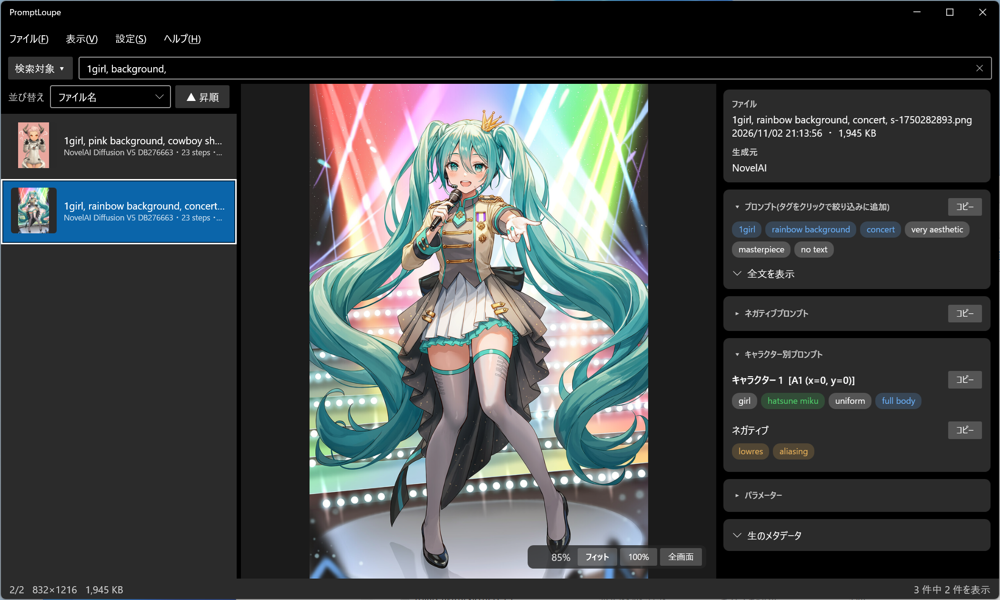

# PromptLoupe

AI生成画像のメタデータを読み取り、それを元に並び替え・絞り込みしながら閲覧できる Windows 用画像ビューア(C# / WPF / .NET 10)。



## ビルドと実行

.NET 10 SDK が必要です。

```
dotnet run
```

単一exeとして配布する場合:

```
dotnet publish -c Release -r win-x64 --self-contained false -p:PublishSingleFile=true
```

共通部分(メタデータの読み取りなど)のテストは、Windows 以外(Linux・Mac)でも実行できます:

```
dotnet test PromptLoupe.Tests
```

main と `claude/` のブランチへのプッシュ、PR のたびに、GitHub Actions でビルドとテストが通るかを確かめています(`.github/workflows/build.yml`)。

### Avalonia 版(開発中)

Windows・Mac・Linux で動く版を `PromptLoupe.Avalonia/` で作っています。WPF 版と同じ機能になるまでは、WPF 版を正式な版とします。Avalonia 版はまだ配布していません。

```
dotnet run --project PromptLoupe.Avalonia
```

WPF 版との違い(今のところ):

- HEIC・TIFF の画像は表示できません(メタデータと撮影情報は読めます)。WebP は Windows の拡張機能がなくても表示できます
- 一覧からのドラッグ持ち出し、ファイルのコピー・切り取り・貼り付け、画像のコピー、プロパティ、使い方の画面は、まだありません
- 設定は WPF 版と同じファイルを使います(Windows では `%AppData%\PromptLoupe`、Mac・Linux では `~/.config/PromptLoupe`)
- Mac のショートカットは Ctrl の代わりに ⌘ です。削除は ⌘+Delete(Backspace)でもできます

## リリースの手順

1. `PromptLoupe.csproj` の `<Version>` を上げて、main にマージする
2. 同じバージョンのタグを付けて push する(例: `git tag v1.6.0` → `git push origin v1.6.0`)
3. GitHub Actions(`.github/workflows/release.yml`)が、自己完結型の単一 exe(.NET のインストール不要)を zip にまとめ、Releases に**下書き**で載せる。タグと `<Version>` が違うと止まる
4. Releases で下書きを開き、「変更点」を書いて「Publish release」を押す

## 初めて起動するとき(SmartScreen の警告)

PromptLoupe の exe にはコード署名をしていません。そのため、ダウンロードした exe を初めて開くと、「Windows によって PC が保護されました」という画面が出ることがあります。

起動するには、「詳細情報」をクリックしてから「実行」を押してください。2回目からは表示されません。

ウイルス対策ソフトが誤って警告することもあります。気になる場合は、上の手順でソースコードからビルドしてください。

## 機能

- 画像表示(PNG / JPEG / WebP / BMP / GIF / TIFF / HEIC)、ホイールでズーム、ドラッグでパン、ダブルクリックでフィット
  - JPEG・WebP は EXIF の回転情報(Orientation)に従って、正しい向きで表示する(サムネイルも同じ)。HEIC は、デコーダー(WIC)が HEIF の回転情報で直して返すので、EXIF の値では回さない
- 撮影情報(Exif): JPEG・WebP・HEIC の EXIF から、カメラ・レンズ・撮影日時・絞り・シャッター速度・ISO 感度・焦点距離・露出補正・撮影モード・フラッシュ・ホワイトバランスを右パネルに表示
  - GPS の位置情報は、初期設定では「記録あり」とだけ表示。メニュー「設定 → 撮影情報の位置情報(GPS)を表示する」で緯度・経度・標高を表示
- フォルダ内閲覧(←→ / PageUp・PageDown / Home・End)、ドラッグ&ドロップ、コマンドライン引数、「このアプリで開く」に対応
- メタデータ読み取り: Stable Diffusion WebUI(A1111/Forge)、ComfyUI、NovelAI、InvokeAI
  - PNG の tEXt / iTXt / zTXt、JPEG・WebP の EXIF UserComment
  - 上記以外のツールでも、`prompt` / `negative_prompt` / `seed` などの一般的な名前の項目を持つ JSON なら、汎用的に読み取る(「不明なツール(JSON: …)」と表示)
  - PixAI は非対応(ダウンロードした画像にプロンプトなどの情報が入っていないため)
- サブフォルダ読み込み: メニュー「設定 → サブフォルダの読み込み」で深さを選択(含めない / 1〜3階層まで / 無制限。既定は含めない、設定は `%AppData%\PromptLoupe\settings.json` に保存)
- サムネイル: ファイル一覧に表示(メニュー「設定 → サムネイルを表示」でON/OFF)。画面に見えている分だけバックグラウンドで生成し、メモリ上にのみ保持(最大600枚、ディスクには保存しません)
- バージョン情報: メニュー「ヘルプ → バージョン情報」(バージョンは `PromptLoupe.csproj` の `<Version>` で管理)
- 並び替え: ファイル名(自然順)・更新日時・撮影日時(EXIF。無ければ更新日時で代用)・サイズ・モデル・サンプラー・ステップ数・CFG
- 絞り込み: ファイル名・プロンプト・ネガティブプロンプト・キャラクター別プロンプト・キャラクター別ネガティブ・モデル名(カンマ区切りでAND。例: `blue hair, 1girl`。検索対象は「検索対象」ボタンで選択)
  - スペースと `_` は同じ扱い(`hatsune miku` = `hatsune_miku`)、`\` のエスケープは無視、大文字小文字は区別しない
- 使い方マニュアル: メニュー「ヘルプ → 使い方」または F1(内容は `HelpWindow.xaml` に埋め込み)
- 表示方式の維持: 「フィット」「100%」のどちらを選んだかを覚え、画像を切り替えても同じ表示方式で開く(次回起動時も保持)
- 見た目: Windows 11 風のデザイン(ModernWpfUI)、テーマはダーク/ライト/Windows の設定に合わせる(メニュー「設定 → テーマ」)
- 絞り込み欄は画面上部でウィンドウの右端まで伸ばし、「検索対象」ボタンはその左に配置
- プロンプト・ネガティブ・キャラクター別・パラメーター・撮影情報の各カードは、見出しのクリックで最小化/展開(状態は保存)
- アプリのアイコンは、写真と、プロンプト(文字)を映す虫眼鏡を組み合わせたデザイン(`app.ico`。`tools/make_icon.ps1` で生成)
- 右パネルはカード表示。プロンプトはタグのチップで表示し、クリックで絞り込み欄に追加/解除(重みやかっこは外した形)
- サムネイルの大きさ(小48 / 中64 / 大96)を選択、画像の右下に表示倍率とフィット/100%ボタン
- プロンプトのコピー、生メタデータの表示
- ファイル操作(左の一覧の右クリックメニュー / キー): コピー・切り取り・貼り付け(エクスプローラーと連携)、名前の変更、削除(ごみ箱へ)、エクスプローラーで開く、既定のアプリで開く、パス・画像・プロンプトのコピー、プロパティ。複数選択に対応
  - 削除は初期設定では無効。「設定 → ファイル操作 → 削除を許可する」でオンにする。「削除の前に確認する」も設定で切り替え(既定はオン)
  - 一覧の画像を、エクスプローラーや他のアプリへドラッグ&ドロップで持ち出せる(既定はコピー、Shift を押しながらで移動)。外からのドロップは、従来どおりそのファイル/フォルダを開く
- 全画面表示(F11 / メニュー「表示」/ 画像右下のボタン。Esc で戻る)
- タグの色分け: Danbooru のタグ辞書(`danbooru.csv`、利用者が用意)で、一般 / アーティスト / 作品名 / キャラクター名 / メタ を色分け。`<lora:…>` などは辞書なしで色分け。メニュー「設定 → タグの色分け」で辞書を読み込む(`%AppData%\PromptLoupe\danbooru.csv` に保存。アプリには同梱しない)。辞書は現時点では [a1111-sd-webui-tagcomplete の danbooru.csv](https://github.com/DominikDoom/a1111-sd-webui-tagcomplete/blob/main/tags/danbooru.csv) を推奨(同じ場所の e621.csv などは分類の番号が違うため不可)
- タグの集計(メニュー「表示 → タグの集計」/ Ctrl+T): タグごとに、使っている画像の枚数と割合を一覧にする
  - 集計するプロンプト(プロンプト / ネガティブ / キャラクター別)、範囲(一覧に表示中の画像 / フォルダのすべて)を選択。列の見出しのクリックで並び替え(もう一度で昇順/降順を切り替え)。条件は保存
  - ダブルクリックか Enter で絞り込みに追加/解除。範囲が「表示中」なら、絞り込みに合わせて自動で集計し直す
  - 選んだタグをカンマ区切りで、一覧をタブ区切りでコピーできる

## キー操作

| キー | 動作 |
|---|---|
| ← / PageUp / Backspace | 前の画像 |
| → / PageDown / Space | 次の画像 |
| Home / End | 最初 / 最後 |
| F | フィット表示 |
| 1 | 等倍(100%) |
| F11 / Esc | 全画面表示の切り替え / 全画面を終了 |
| Ctrl+C / Ctrl+X / Ctrl+V | 選んだファイルのコピー / 切り取り / 貼り付け |
| F2 | 名前の変更 |
| Delete | ごみ箱へ移動(設定で許可しているとき) |
| Ctrl+Shift+C | ファイルのパスをコピー |
| Ctrl+T | タグの集計 |

## 構成

**PromptLoupe.Core/**(OS に依存しない共通部分。Linux・Mac でもビルドできる)

- `Metadata/MetadataReader.cs` — 各形式のメタデータ抽出と、生成ツールごとの解釈
- `Metadata/ImageMetadata.cs` — 解釈済みメタデータのモデル
- `Metadata/ExifInfo.cs` — EXIF の撮影情報と、表示用の整形
- `PromptText.cs` — 検索用の正規化、プロンプトのタグへの分割
- `NaturalComparer.cs` — 自然順(img2 が img10 より前)の比較(Avalonia 版で使う)
- `AppSettings.cs` — 設定の保存
- `TagDictionary.cs` — タグ辞書の読み込み

**PromptLoupe.Tests/** — 共通部分のテスト(`dotnet test PromptLoupe.Tests`)

**PromptLoupe.Avalonia/**(Avalonia の画面。開発中)

- WPF 版と同じ名前のファイル(`MainWindow.*`・`FileItem.cs`・`ThumbnailService.cs` など)は、同じ役割
- `ImageLoader.cs` — 画像の読み込み(SkiaSharp)と、JPEG・WebP の EXIF 回転の補正
- `PlatformShell.cs` — 既定のアプリで開く・ファイルマネージャーで表示・ごみ箱へ移す(OS ごとの処理)
- `MessageDialog.cs` — メッセージのダイアログ

**ルート**(WPF の画面。Windows 専用)

- `FileItem.cs` — 一覧の項目と並び替え用コンパレーター
- `ThumbnailService.cs` — サムネイルの生成とメモリキャッシュ
- `ExifOrientation.cs` — JPEG・WebP の EXIF 回転情報の読み取りと、向きの補正
- `MainWindow.FileOps.cs` — ファイル操作とドラッグ&ドロップ(持ち出し)
- `MainWindow.Fullscreen.cs` — 全画面表示
- `MainWindow.Tags.cs` — タグの色分け
- `RenameWindow.xaml(.cs)` — 名前の変更ダイアログ
- `TagStatsWindow.xaml(.cs)` / `MainWindow.TagStats.cs` — タグの集計
- `MainWindow.xaml(.cs)` — UI
- `HelpWindow.xaml(.cs)` — 使い方マニュアル

## ライセンス

PromptLoupe は [MIT License](LICENSE) で配布しています(Copyright (c) 2026 yuto)。

### 使用ライブラリ

- [ModernWpfUI](https://github.com/Kinnara/ModernWpf)(MIT License、Copyright (c) 2019 Yimeng Wu)— 画面のデザイン
- .NET / WPF(MIT License)

ModernWpfUI のライセンス文は [THIRD-PARTY-NOTICES.txt](THIRD-PARTY-NOTICES.txt) にあります。
`LICENSE` と `THIRD-PARTY-NOTICES.txt` は、ビルド・発行のたびに出力先へコピーされます。配布するときは、この2つを exe と一緒に入れてください。

## 既知の制限

- WebP の表示には Windows の「WebP 画像拡張機能」が必要です(メタデータ読み取りは不要)
- HEIC の表示には Windows の「HEIF 画像拡張機能」と「HEVC ビデオ拡張機能」が必要です。TIFF の撮影情報(Exif)の読み取りは未対応
- GIF アニメーションは先頭フレームのみ表示
- サムネイルのグリッド表示は未対応(標準の WrapPanel は大量の画像で重くなるため)
